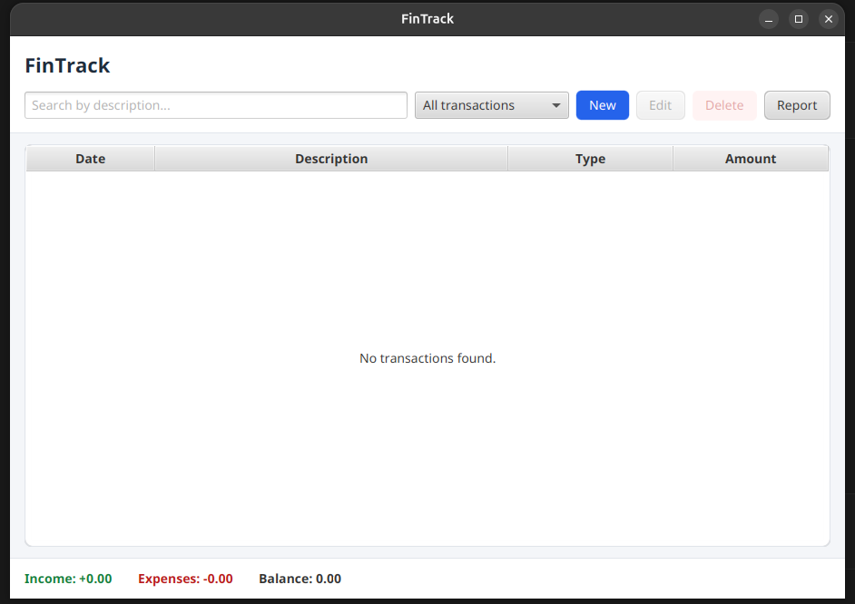
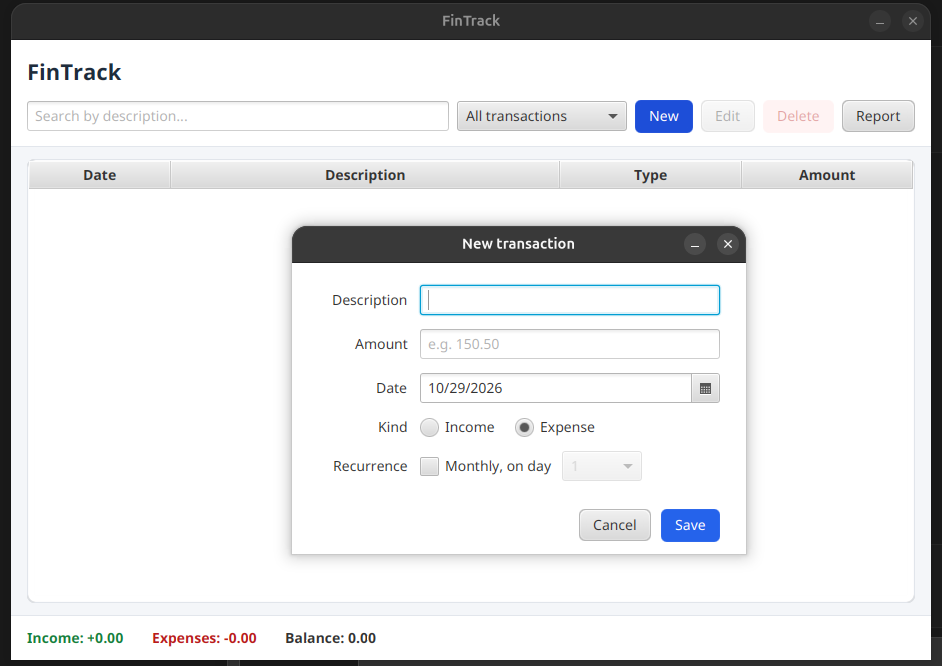

# FinTrack

A personal finance tracker with a JavaFX desktop interface and MySQL persistence. FinTrack lets you record income and expenses (including recurring monthly transactions), search and filter your history, and see your balance in a summary report.

It started as a console application (tagged [`v1.0-console`](https://github.com/PedroSgorla/FinTracker/releases/tag/v1.0-console)) and was migrated to JavaFX, JDBC, Generics, and JUnit as part of the intermediate Java course project.

## Screenshots

| Main window | New transaction |
|---|---|
|  |  |

## Features

- Add income and expense transactions, including recurring monthly ones (tied to a day of the month)
- Edit and delete transactions (deleting asks for confirmation)
- Search by description while you type
- Filter by All, Income, Expenses, or Monthly
- Summary bar with total income, total expenses, and balance
- Report window with the totals and a bar chart comparing income and expenses
- Input validation with clear messages (empty description, non-positive amount, invalid day of month, invalid number)
- Data is stored in MySQL, so it survives restarts

## Tech Stack

- Java 25
- JavaFX 25 (FXML, CSS)
- MySQL 8.4 with JDBC (`mysql-connector-j`)
- Maven
- JUnit 6 (Jupiter)

## Architecture

```
JavaFX UI (FXML + controllers)  ->  FinTracker (business logic)  ->  Repository<Transaction, Long>
                                                                          |-- TransactionDAO (MySQL, JDBC)
                                                                          |-- InMemoryRepository (tests)
```

- The **UI** never talks to the database. It only calls `FinTracker`.
- `FinTracker` depends on the generic `Repository` interface, not on MySQL. The application passes it a `TransactionDAO`, and the unit tests pass it an `InMemoryRepository`.
- Validation lives in the model (`Transaction`, `MonthlyTransaction`), so an invalid object can never exist.

## Project Structure

```
FinTracker/
├── pom.xml                               # Maven build configuration
├── README.md
├── docs/screenshots/                     # Images used in this README
└── src/
    ├── main/
    │   ├── java/com/fintrack/
    │   │   ├── app/
    │   │   │   ├── FinApp.java           # JavaFX entry point
    │   │   │   └── Launcher.java         # Plain main() to start the app from an IDE
    │   │   ├── ui/                       # JavaFX controllers
    │   │   │   ├── MainController.java
    │   │   │   ├── TransactionFormController.java
    │   │   │   ├── ReportController.java
    │   │   │   └── Alerts.java
    │   │   ├── controller/
    │   │   │   └── FinTracker.java       # Business logic
    │   │   ├── model/
    │   │   │   ├── Identifiable.java
    │   │   │   ├── Transaction.java
    │   │   │   ├── MonthlyTransaction.java
    │   │   │   └── TransactionType.java
    │   │   ├── repository/
    │   │   │   ├── Repository.java       # Generic repository interface
    │   │   │   └── InMemoryRepository.java
    │   │   ├── dao/
    │   │   │   └── TransactionDAO.java   # MySQL implementation
    │   │   ├── db/
    │   │   │   ├── DatabaseConnection.java
    │   │   │   └── ConnectionProvider.java
    │   │   ├── exceptions/
    │   │   │   ├── InvalidInputException.java
    │   │   │   └── DataAccessException.java
    │   │   └── utils/
    │   │       └── Formatter.java
    │   └── resources/com/fintrack/
    │       ├── view/                     # FXML screens
    │       │   ├── main-view.fxml
    │       │   ├── transaction-form.fxml
    │       │   └── report-view.fxml
    │       └── css/style.css
    └── test/java/com/fintrack/
        ├── db/DatabaseConnectionTest.java
        ├── dao/TransactionDAOTest.java
        ├── model/                        # Transaction and MonthlyTransaction tests
        ├── repository/InMemoryRepositoryTest.java
        └── controller/FinTrackerTest.java
```

## Requirements

- Java 25 (JDK)
- Maven 3.9+
- MySQL 8.x (the instructions below use Docker)

## Database Setup

1. Start a MySQL container. Port `3307` is used on the host, so it does not clash with a MySQL already installed on the machine:

   ```bash
   docker run --name fintrack-mysql -e MYSQL_ROOT_PASSWORD=root123 -e MYSQL_DATABASE=fintrack -p 3307:3306 -v fintrack-data:/var/lib/mysql -d mysql:8.4
   ```

2. Open a MySQL shell:

   ```bash
   docker exec -it fintrack-mysql mysql -u root -p
   ```

3. Create the table in the application database, and again in a separate database used by the tests:

   ```sql
   CREATE DATABASE IF NOT EXISTS fintrack_test;

   USE fintrack;

   CREATE TABLE transactions (
       id               BIGINT AUTO_INCREMENT PRIMARY KEY,
       description      VARCHAR(255) NOT NULL,
       amount           DECIMAL(10,2) NOT NULL,
       is_income        BOOLEAN NOT NULL,
       transaction_date DATE NOT NULL,
       type             VARCHAR(10) NOT NULL,
       day_of_month     TINYINT NULL,
       CONSTRAINT chk_amount CHECK (amount > 0),
       CONSTRAINT chk_type   CHECK (type IN ('REGULAR', 'MONTHLY')),
       CONSTRAINT chk_day    CHECK (day_of_month IS NULL OR day_of_month BETWEEN 1 AND 31)
   );

   USE fintrack_test;
   -- run the same CREATE TABLE statement again here
   ```

Regular and monthly transactions share one table. The `type` column tells them apart, and `day_of_month` is only filled for monthly ones.

## Configuration

The database connection is read from environment variables. The defaults match the Docker command above and are meant for local development only:

| Variable | Default |
|---|---|
| `FINTRACK_DB_URL` | `jdbc:mysql://localhost:3307/fintrack` |
| `FINTRACK_DB_USER` | `root` |
| `FINTRACK_DB_PASSWORD` | `root123` |
| `FINTRACK_TEST_DB_URL` | `jdbc:mysql://localhost:3307/fintrack_test` (used by the DAO tests) |

For example, to use a MySQL running on the default port 3306:

```bash
FINTRACK_DB_URL="jdbc:mysql://localhost:3306/fintrack" mvn compile javafx:run
```

## Build & Run

From the repository root (the folder that contains `pom.xml`), with the database running:

```bash
mvn compile javafx:run
```

To start the application from an IDE, run `com.fintrack.app.Launcher`. Do not run `FinApp` directly: a class that extends `Application` cannot be started from the classpath ("JavaFX runtime components are missing").

## Tests

```bash
mvn test
```

- Model, `FinTracker`, and `InMemoryRepository` tests run without a database.
- `TransactionDAOTest` and `DatabaseConnectionTest` need the MySQL container running. The DAO tests use the separate `fintrack_test` database and refuse to run against any other one, because they delete all rows before each test.

To run a single test class:

```bash
mvn test -Dtest=TransactionTest
```

## Notes

- Money is stored as `BigDecimal` (`DECIMAL(10,2)` in MySQL) with two decimal places, to avoid floating-point rounding errors.
- The amount field accepts both `150.50` and `150,50`.
- All SQL uses `PreparedStatement`, so user input is never concatenated into queries.
- Each DAO operation opens and closes its own connection, which keeps the code simple. A connection pool would be the next step for a larger application.
